# Курсовая работа: решение по этапам

Отказоустойчивая инфраструктура сайта в Yandex Cloud: Terraform создаёт ресурсы, Ansible настраивает ВМ.
Здесь по этапам описано, что сделано, какие файлы за это отвечают и чем подтверждён результат.

## Статус

| Этап | Что | Статус |
| --- | --- | --- |
| 0 | Подготовка: репозиторий, каталог в облаке, удалённое состояние | готово |
| 1 | Сеть: VPC, подсети, NAT, группы безопасности | готово |
| 2 | Bastion и доступ по ssh | готово |
| 3 | Сайт: две ВМ с nginx и Application Load Balancer | готово |
| 4 | Образы Elastic и Grafana в Yandex Container Registry | готово |
| 5 | Мониторинг: Prometheus, exporters, Grafana | готово |
| 6 | Логи: Elasticsearch, Filebeat, Kibana | готово |
| 7 | Резервное копирование: снапшоты дисков | в работе |
| 8 | Дополнительно (по желанию) | впереди |
| 9 | Итоговое оформление | впереди |

## Архитектура

| Хост | Зона | Подсеть | Входящий трафик |
| --- | --- | --- | --- |
| bastion | a | публичная 10.10.0.0/24 | 22 из интернета |
| web-1, web-2 | a, d | приватные 10.10.10.0/24, 10.10.11.0/24 | 80 от ALB, 9100 и 4040 от Prometheus, 22 от bastion |
| prometheus | a | приватная | 9090 от Grafana, 22 от bastion |
| grafana | d | публичная 10.10.1.0/24 | 3000 из интернета, 22 от bastion |
| elasticsearch | d | приватная | 9200 от Kibana и web, 9100 от Prometheus, 22 от bastion |
| kibana | d | публичная | 5601 из интернета, 9100 от Prometheus, 22 от bastion |
| ALB | a, d | публичные | 80 из интернета, проверки состояния Яндекса |

Приватные ВМ не имеют публичных адресов и выходят в интернет через NAT-шлюз.
SSH к любой ВМ разрешён только из группы безопасности bastion.

## Этап 0. Подготовка

- Отдельный каталог облака `coursework`; сервисный аккаунт `terraform-sa` с ролью `editor` на него.
- Состояние Terraform хранится в Object Storage (бакет `tfstate-ilembet-portfolio`, ключ `coursework/terraform.tfstate`).
- `terraform/env.sh` выдаёт временный IAM-токен через impersonation: ключей сервисного аккаунта на диске нет.

Файлы: `terraform/versions.tf`, `terraform/env.sh`.

## Этап 1. Сеть

- VPC `course-net`, по одной публичной и одной приватной подсети в зонах `ru-central1-a` и `ru-central1-d`.
- NAT-шлюз и таблица маршрутов для приватных подсетей.
- Семь групп безопасности: на каждую роль открыты только нужные порты.

Файлы: `terraform/network.tf`, `terraform/security.tf`.

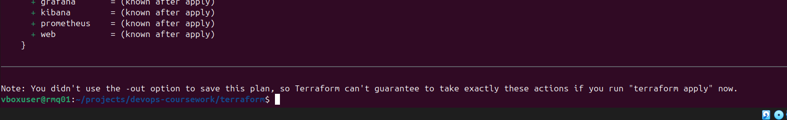
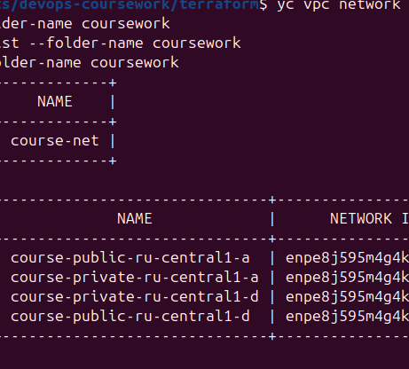

## Этап 2. Bastion

- ВМ `bastion` с публичным адресом; наружу открыт только порт 22.
- `scripts/ssh-config.sh` пишет `~/.ssh/coursework.conf`: `ssh bastion` и вход на любую `10.10.*` через ProxyJump.

Проверка: порт 80 закрыт, порт 22 открыт.

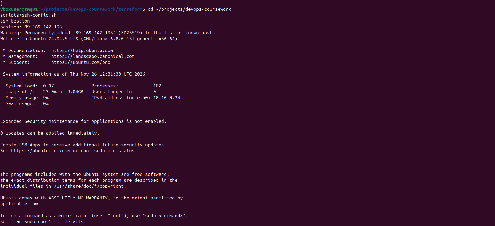
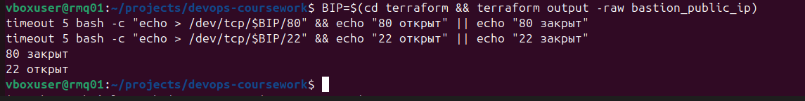

## Этап 3. Сайт и балансировщик

- Две одинаковые ВМ `web-1` (зона a) и `web-2` (зона d) без публичных адресов.
- Ansible-роль `nginx` ставит nginx и статический сайт; заголовок `X-Backend` показывает, какая ВМ ответила.
- Target Group, Backend Group (healthcheck `/`, порт 80, HTTP), HTTP router (путь `/`), ALB с listener на порту 80.
- `scripts/inventory.sh` строит инвентарь Ansible из outputs Terraform.

Файлы: `terraform/compute.tf`, `terraform/alb.tf`, `ansible/roles/nginx/`, `scripts/inventory.sh`.

Проверка `curl -v <IP балансировщика>:80`: ответ `200 OK`, полный вывод в [stage3-curl.txt](stage3-curl.txt).
Запросы чередуются между `web-1` и `web-2`. При остановленной `web-1` сайт продолжает отвечать с `web-2`.

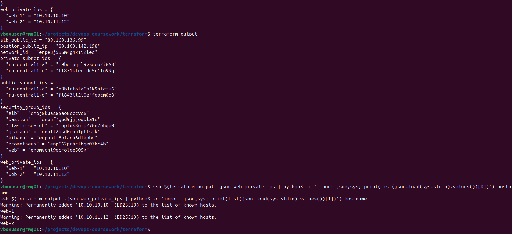
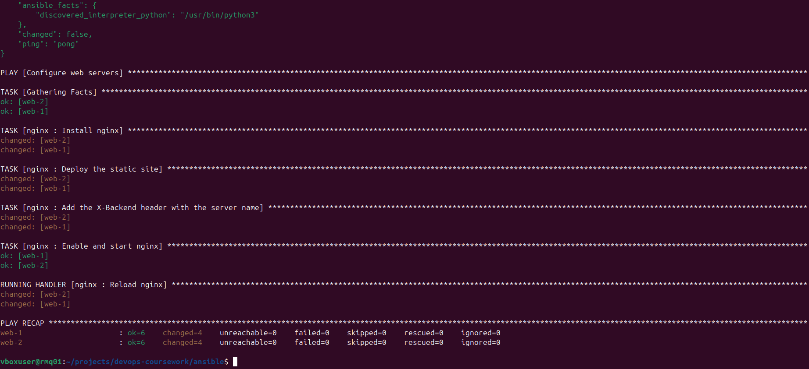
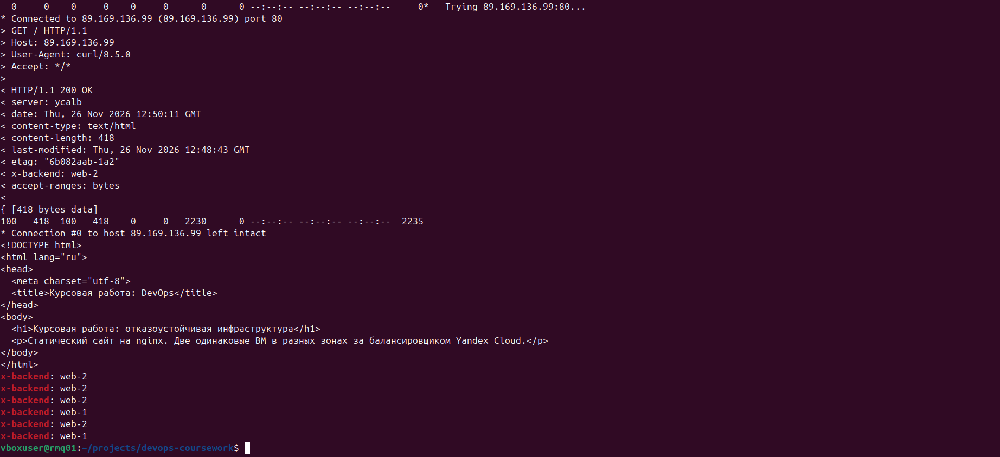
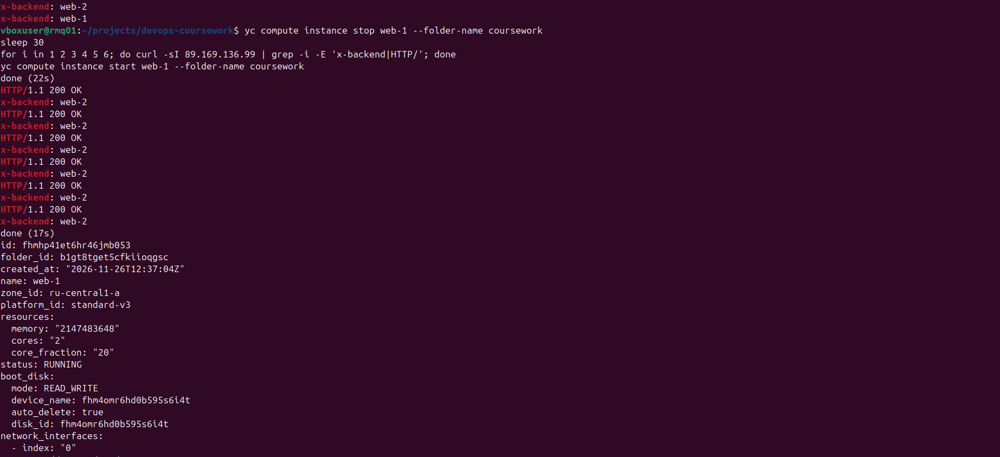

## Этап 4. Образы в Container Registry

Из приватных подсетей и зоны d недоступны Docker Hub и внешние реестры, а загрузки Elastic из РФ часто закрыты.
Поэтому официальные образы `elasticsearch`, `kibana`, `filebeat` (8.19.0) и `grafana` (11.5.2) один раз перенесены
в Yandex Container Registry. ВМ получают их от сервисного аккаунта `vm-puller` с ролью `images.puller`.


## Этап 5. Мониторинг

- ВМ `prometheus` (приватная) и `grafana` (публичная).
- `node_exporter` на всех ВМ, `prometheus-nginxlog-exporter` на web (метрики из `access.log`, порт 4040).
- Prometheus из пакетов Ubuntu, конфиг генерируется из инвентаря и проверяется `promtool` перед применением.
- Grafana в Docker. Источник данных и дашборд описаны кодом (provisioning), пароль администратора берётся из
  переменной окружения и в git не попадает.
- Дашборд «Coursework: USE + HTTP»: Utilization, Saturation и Errors для CPU, RAM, дисков и сети,
  плюс `nginx_http_response_count_total` и `nginx_http_response_size_bytes`. На всех панелях заданы пороги.

Файлы: `terraform/compute.tf`, `ansible/roles/{node_exporter,nginx_log_exporter,prometheus,grafana}/`.

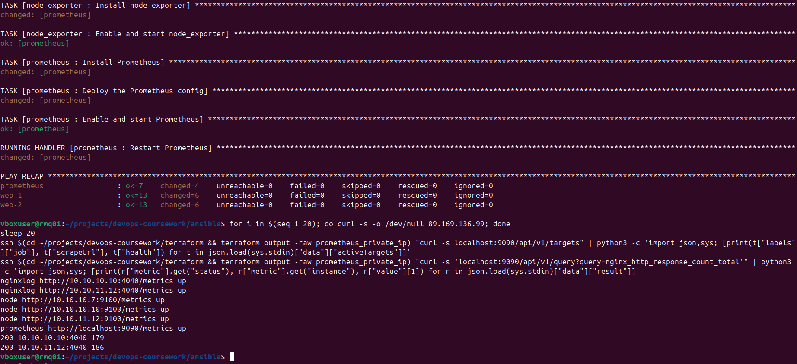
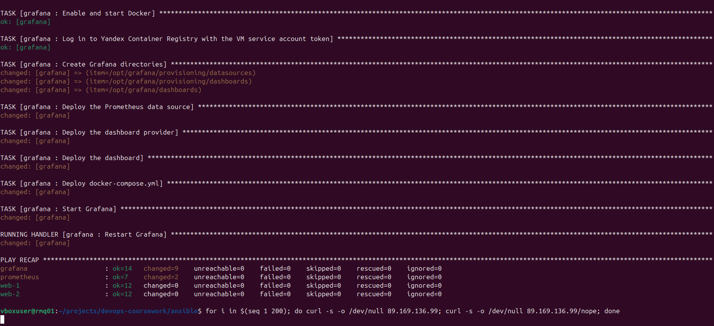
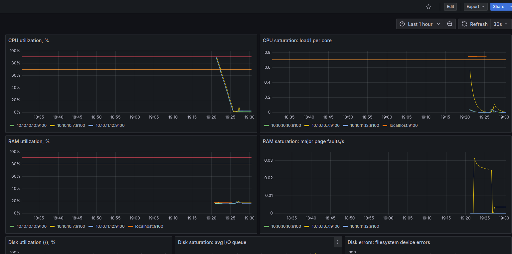
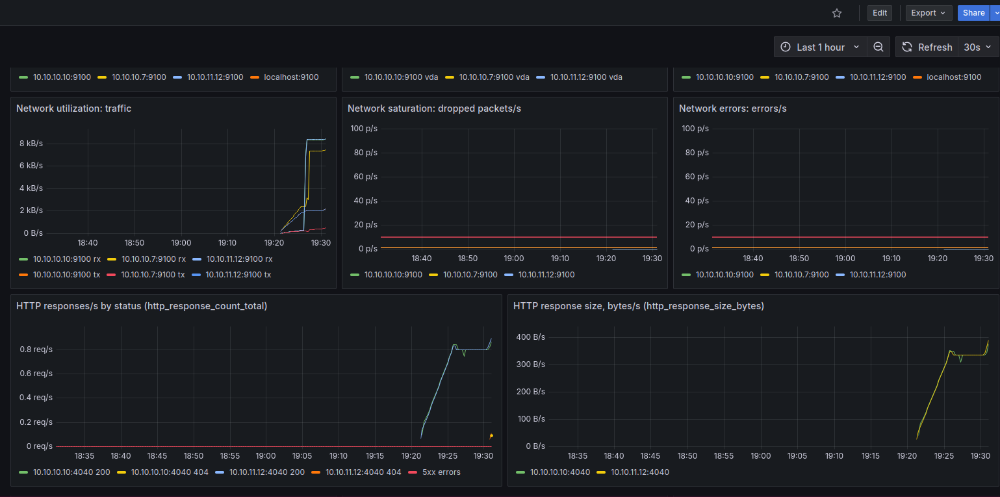

## Этап 6. Логи

- ВМ `elasticsearch` (приватная подсеть) и `kibana` (публичная), обе в зоне d. Elasticsearch 8.19 в Docker в режиме
  single-node, Kibana 8.19 в Docker подключена к нему.
- Filebeat в Docker на обеих web-ВМ читает `/var/log/nginx/access.log` и `/var/log/nginx/error.log` и отправляет их
  в Elasticsearch. Поле `log_type` (`nginx-access` / `nginx-error`) разделяет логи, `agent.name` показывает ВМ.
- Общая роль `docker` ставит Docker и входит в реестр токеном сервисного аккаунта ВМ; ей пользуются Grafana,
  Elasticsearch, Kibana и Filebeat.

Файлы: `terraform/compute.tf`, `ansible/roles/{docker,elasticsearch,kibana,filebeat}/`.

Проверка: в Elasticsearch появился поток данных `filebeat-8.19.0` (около 3 600 записей access-лога и записи
error-лога). В Kibana создан data view `filebeat-*`, в Discover видны логи `web-1` и `web-2`. Большая часть
записей — проверки состояния балансировщика (`Envoy/HC`).

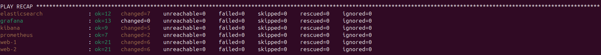
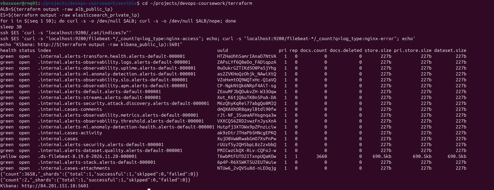
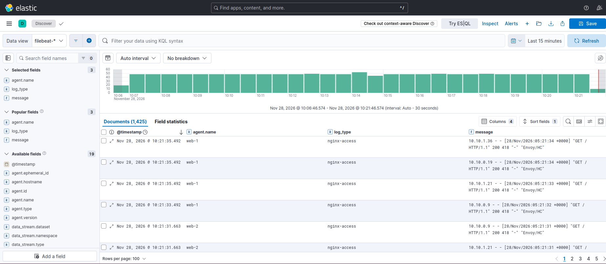

## Этапы 7–9

Будут описаны по мере выполнения.

## Решения и компромиссы

| Решение | Почему | Цена |
| --- | --- | --- |
| NAT-шлюз для приватных подсетей | Приватным ВМ нужны пакеты и образы | Платный ресурс; стек удаляется после работы |
| Образы через Yandex Container Registry | Внешние реестры недоступны из облака | Образы переносятся вручную один раз |
| Диск Prometheus на SSD | Исчерпана квота HDD в зоне a | SSD немного дороже за ГБ |
| Grafana в Docker | Официальный apt-репозиторий Grafana может быть недоступен | На ВМ нужен Docker |
| Метрики nginx с префиксом `nginx_` | Так экспортёр задаёт namespace | Имена отличаются от задания префиксом |
| Прерываемые ВМ, 20% vCPU | Экономия бюджета учебного облака | ВМ может быть остановлена облаком |
| Одна ВМ Elasticsearch | Достаточно по заданию | Нет отказоустойчивости слоя логов |
| Безопасность Elasticsearch отключена | ES в приватной подсети, порт 9200 открыт только группам Kibana и web | Kibana открыта без пароля; в реальном проекте нужны TLS и пользователи |
| Elasticsearch и Kibana в зоне d, SSD 10 ГБ, 20% vCPU | Квоты пробного облака по зонам: 2 vCPU с учётом доли, HDD 20 ГБ, SSD 10–30 ГБ | Медленный старт (несколько минут) |

## Как поднять с нуля

```bash
source terraform/env.sh
cd terraform && terraform init && terraform apply && cd ..
scripts/ssh-config.sh
scripts/inventory.sh
export GRAFANA_ADMIN_PASSWORD=...   # 8+ символов
cd ansible && ansible-playbook site.yml
```

В конце работы: `cd terraform && terraform destroy`.
